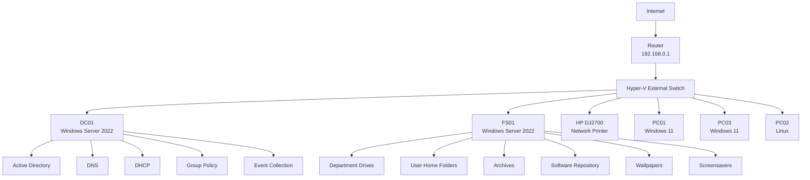
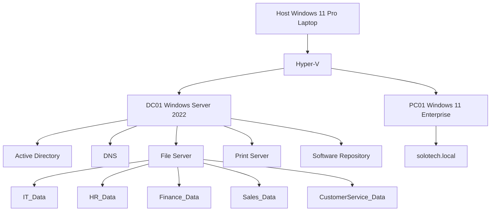
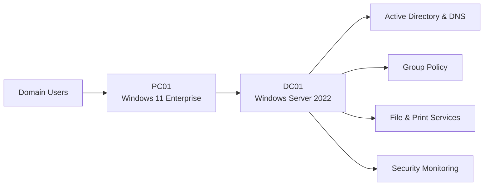
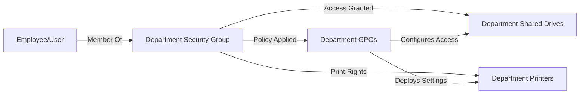
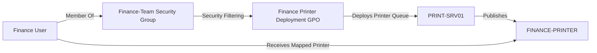
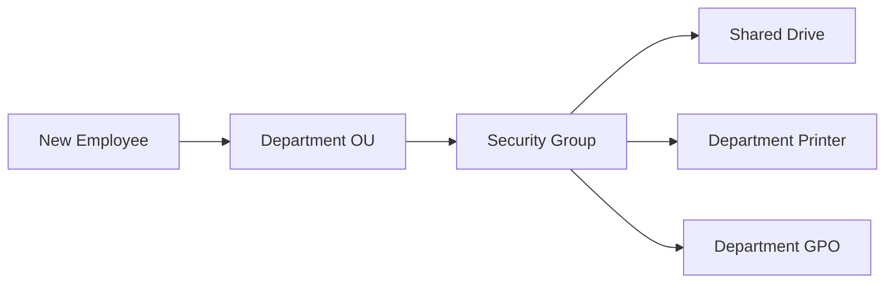
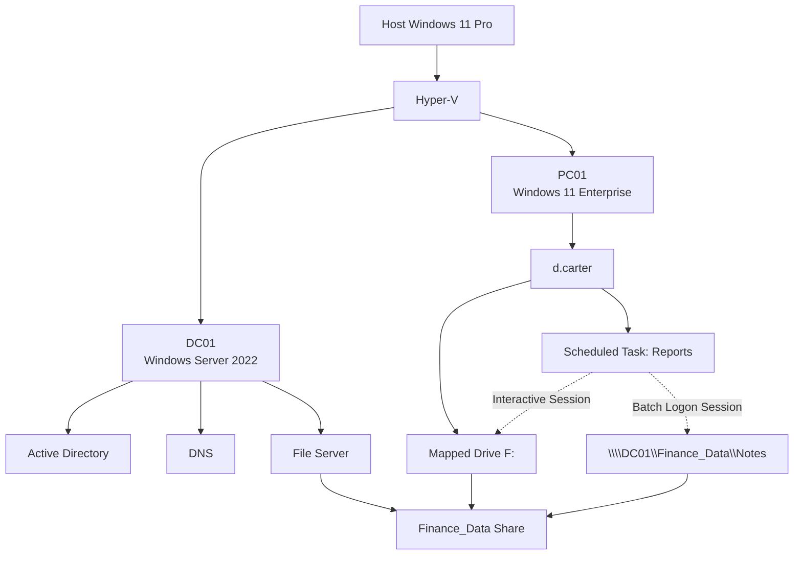
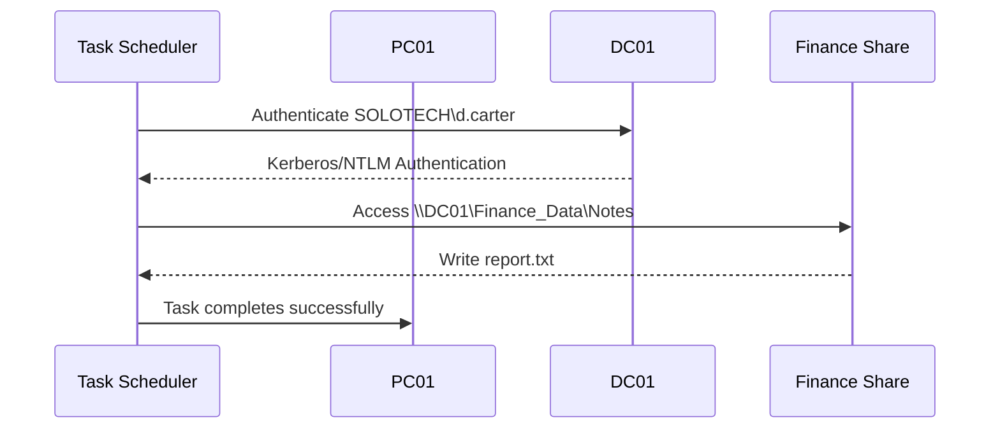

# Architecture

This folder contains diagrams and design documents for the SoloTech environment.
Project reports and technical documents.

## Enterprise Architecture




# SoloTech Active Directory Lab



# Technical Architecture



---

# RBAC Model

This diagram illustrates role-based access control (RBAC) using Active Directory security groups.



## Access Flow

1. User is added to a Department Security Group.
2. The Security Group grants access to shared drives.
3. The Security Group grants access to department printers.
4. Group Policies are applied based on group membership.
5. GPOs configure resources and deploy settings automatically.

---

# Printer Architecture

This diagram shows printer deployment through Active Directory security groups and Group Policy.



## User Provisioning Model




## Network Diagram

The following diagram shows the infrastructure used during the Scheduled Task Authentication and Network Drive Troubleshooting Lab.



### Network Resource Flow

#### Interactive User Session

When `d.carter` signs into Windows:

```text
d.carter
    ↓
Desktop Session
    ↓
Mapped Drive F:
    ↓
\\DC01\Finance_Data
```

The Finance department share is available through the mapped drive and can be accessed normally through File Explorer, PowerShell, and Command Prompt.

---

#### Scheduled Task Session

When Task Scheduler launches the task:

```text
Task Scheduler
    ↓
Batch Logon Session
    ↓
No Explorer Session
    ↓
No Mapped Drives
```

The scheduled task cannot see the `F:` drive because mapped drives only exist inside the interactive desktop session.

---

#### Successful Enterprise Solution

Instead of relying on a mapped drive letter:

```text
F:\Notes\report.txt
```

the task was updated to use the UNC path:

```text
\\DC01\Finance_Data\Notes\report.txt
```

This allows the task to access the file share regardless of whether the user is logged on interactively.

---

### Authentication Flow



### Key Architecture Lessons

- Interactive sign-in sessions and Task Scheduler batch sessions are separate security contexts
