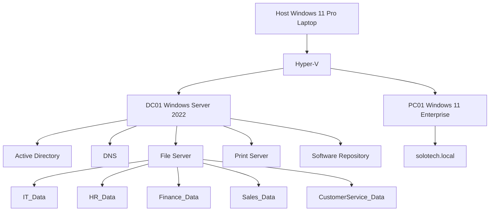
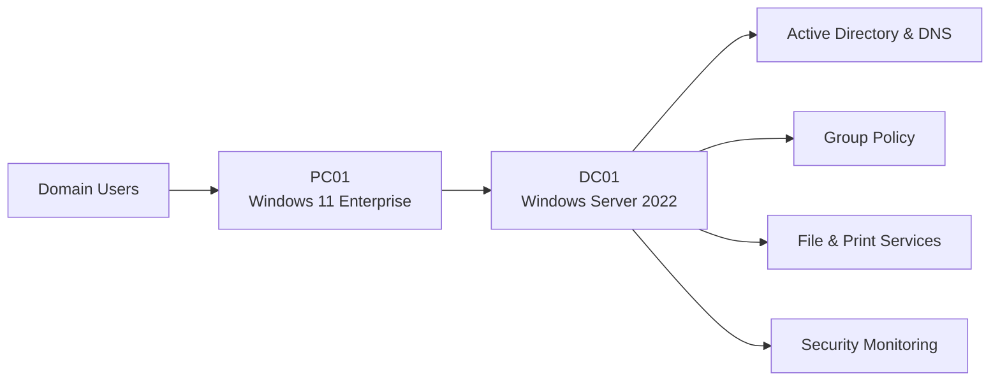
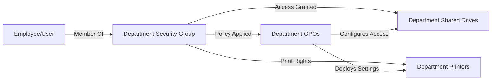
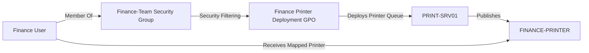
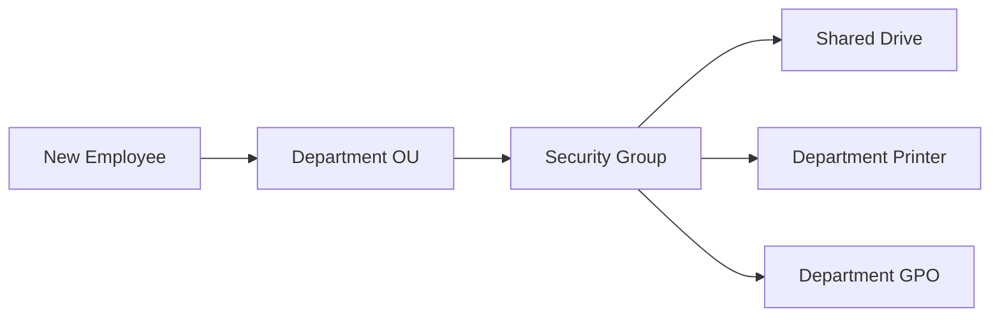

# Documentation

Project reports and technical documents.

# SoloTech Active Directory Lab

# Technical Architecture

---

# RBAC Model

This diagram illustrates role-based access control (RBAC) using Active Directory security groups.

## Access Flow

1. User is added to a Department Security Group.
2. The Security Group grants access to shared drives.
3. The Security Group grants access to department printers.
4. Group Policies are applied based on group membership.
5. GPOs configure resources and deploy settings automatically.

---

# Printer Architecture

This diagram shows printer deployment through Active Directory security groups and Group Policy.

## User Provisioning Model

## Printer Deployment Flow

1. User belongs to the Finance-Team security group.
2. Group Policy security filtering evaluates membership.
3. The printer deployment GPO applies.
4. The printer queue is mapped from the print server.
5. The department printer becomes available to the user.
