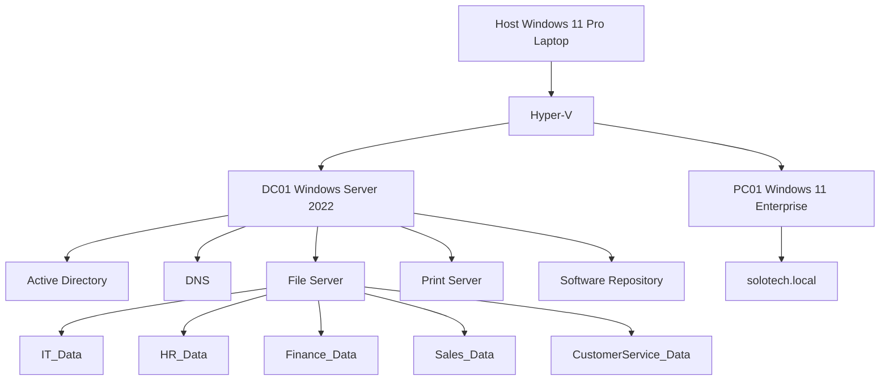
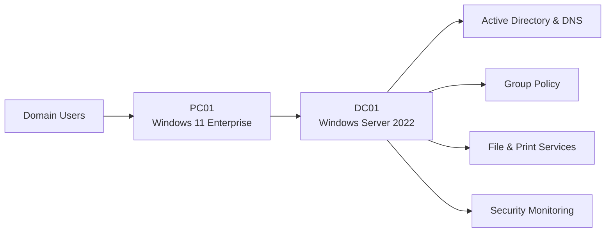
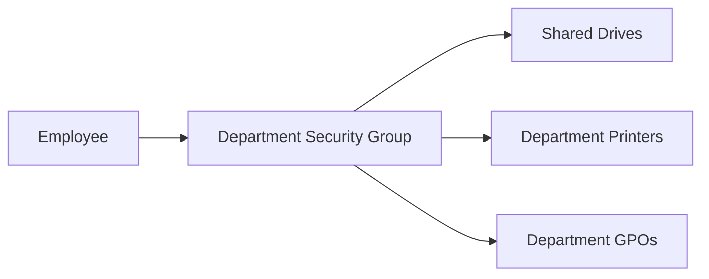
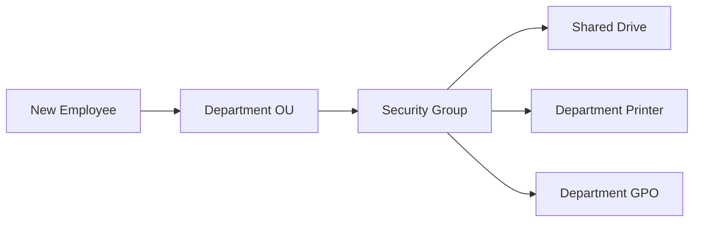
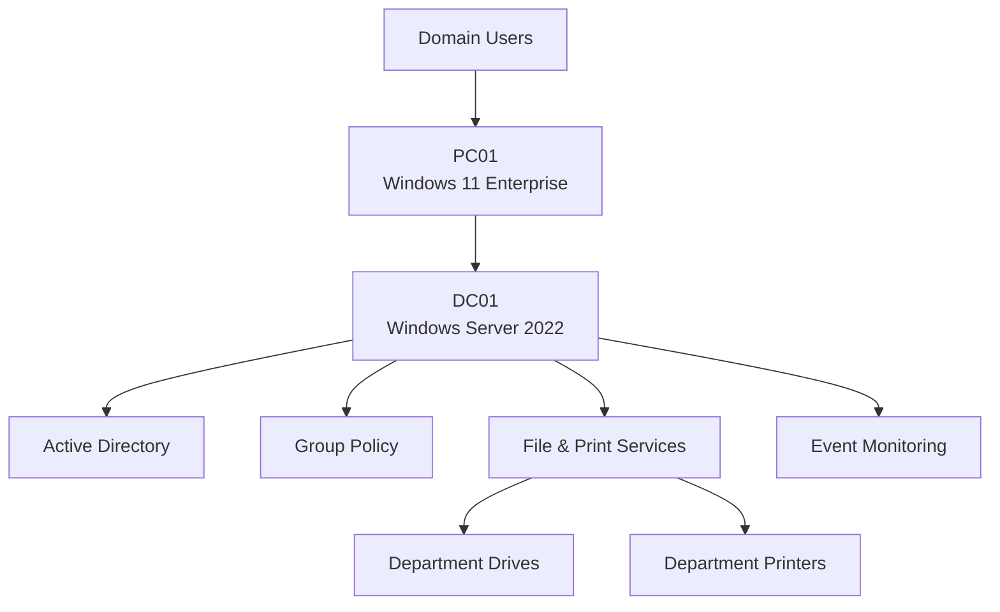
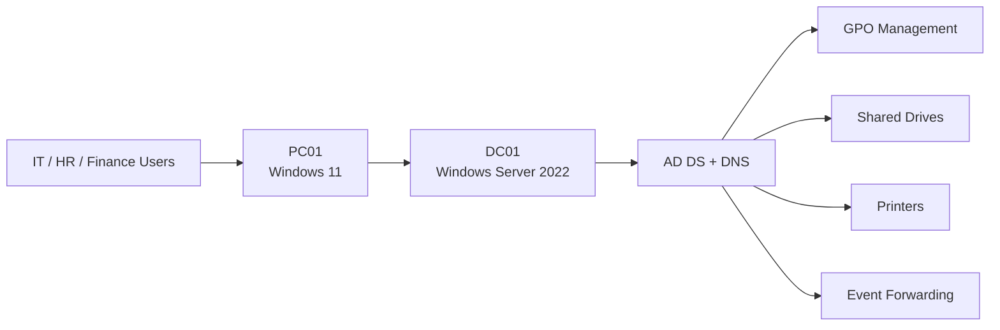
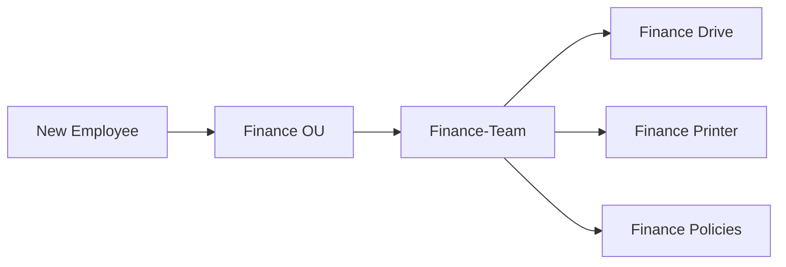

# Documentation

Project reports and technical documents.


# SoloTech Active Directory Lab



# Technical Architecture



---

```

## RBAC Model



---

```

## Printer Architecture


---

```

# Automated & Self-Cleaning Enterprise Printer Deployment Architecture

A centralized, automated, and self-cleaning printer deployment solution utilizing **Windows Server 2022 Active Directory Domain Services (AD DS)**, **Group Policy Preferences (GPP)**, and **Item-Level Targeting**. 

This architecture ensures that users automatically map and default to their respective department's printers based strictly on their Active Directory security group memberships with zero manual IT support intervention.

---

## 🛠️ Architecture Workflow Diagram

```text
[ Active Directory Users ]
           │
           ▼
┌────────────────────────────────────────────────────────┐
│  1. User Logs On / GPO Triggers                       │
└────────────────────────────────────────────────────────┘
           │
           ▼
┌────────────────────────────────────────────────────────┐
│  2. Registry Preference (Processes First)              │
│     Sets: LegacyDefaultPrinterMode = 1                 │
│     Blocks: "Allow Windows to manage my default..."    │
└────────────────────────────────────────────────────────┘
           │
           ▼
┌────────────────────────────────────────────────────────┐
│  3. GPP Printer 'Replace' Cycle Evaluated             │
└────────────────────────────────────────────────────────┘
           │
           ├─► [User in 'Print-Finance' Group?] ──► YES: Map Finance Printer & Set Default
           │                                    └──► NO:  [Remove Device if previously mapped]
           │
           └─► [User in 'Print-HR' Group?]      ──► YES: Map HR Printer & Set Default
                                                └──► NO:  [Remove Device if previously mapped]
```

---

## 🎯 Technical Challenges Addressed

1. **Departmental Isolation:** Restricting network printer visibility so users can only see, list, and interact with their specific department's hardware.
2. **Dynamic Cross-Department Transfers:** Automatically purging stale printer mappings when a user shifts to a new department or security group, mitigating profile clutter.
3. **The "Print to PDF" Hijack:** Preventing Windows 10/11 client machines from falling back to "Microsoft Print to PDF" as the system default during policy refresh cycles.
4. **Permissions Overhead:** Preserving standard print server Access Control Lists (ACLs) to ensure drivers pull reliably without throwing "Access Denied" errors.

---

## ⚙️ Core Implementation Details

### 1. Visibility Filter via Item-Level Targeting
Instead of deploying printers globally to an entire Organizational Unit (OU), mappings are controlled via targeted Active Directory Security Groups (e.g., `Print-Finance`, `Print-HR`).
* **GPO Location:** `User Configuration` > `Preferences` > `Control Panel Settings` > `Printers`
* **Filtering Gatekeeper:** Configured on the **Common Tab** using **Item-Level Targeting**, mapping the preference rule specifically to `User is a member of the Security Group`.
* **Print Server Security:** Permissions on the Print Server are left at their healthy default (**Everyone: Print**). Security is cleanly managed at the GPO presentation layer rather than the server's ACLs.

### 2. Automated Self-Cleaning Configuration
To ensure the environment stays entirely clean if an employee changes departments, the policy alters the default GPO behavior:
* Enabled **"Remove this item when it is no longer applied"** under the GPP Common Tab.
* This changes the internal mechanics from an *Update* action to a **Replace** action (symbolized by a **Red Icon** in the Group Policy Management Console).
* At every background policy check or login, Windows validates group membership. If membership has been stripped, the old device is instantly deleted from the client workstation.

### 3. Securing the Default Status
Because the *Replace* action quickly tears down and rebuilds network printers during background refreshes, Windows clients can temporarily drop the network connection for a split second, defaulting back to *Microsoft Print to PDF*.

This layout guarantees absolute default persistence by enforcing two rules in a precise **Order of Operations**:
* **Administrative Template:** Enforced `Turn off Windows default printer management` under *User Configuration > Policies > Administrative Templates > Control Panel > Printers*.
* **Registry Pre-Conditioning:** Deployed a GPP Registry update to push `LegacyDefaultPrinterMode = 1` (REG_DWORD) under `HKCU\Software\Microsoft\Windows NT\CurrentVersion\Windows`.

# Technical Architecture Diagram

``
## User Provisioning Model


    EVENTS --> LOGON[Logon Events]
    EVENTS --> LOCKOUT[Account Lockouts]
    EVENTS --> MANAGEMENT[Account Management Events]

    PAYGROUP --> PAYROLL

```

* **The Fix:** Because **Windows Settings (Registry)** processes cleanly before **Control Panel Settings (Printers)**, Windows is safely locked into classic printer management *before* the printer's replace cycle triggers, successfully maintaining the primary department printer's default status.

---

## 🚀 Results & Impact

* **Zero-Touch IT Lifecycle Management:** Onboarding or transferring an employee dynamically provisions their localized workplace printing setup without desktop support tickets.
* **Confidentiality Assistance:** Minimizes security leaks where users mistakenly send sensitive data to the wrong department's physical queue.
* **Consistent User Profiles:** Eradicates local registry drift and driver anomalies across user desktop configurations.


## SoloTech Infrastructure Architecture


``
## SoloTech Active Directory Environment


## Printer Deployment Model


## User Provisioning Workflow




