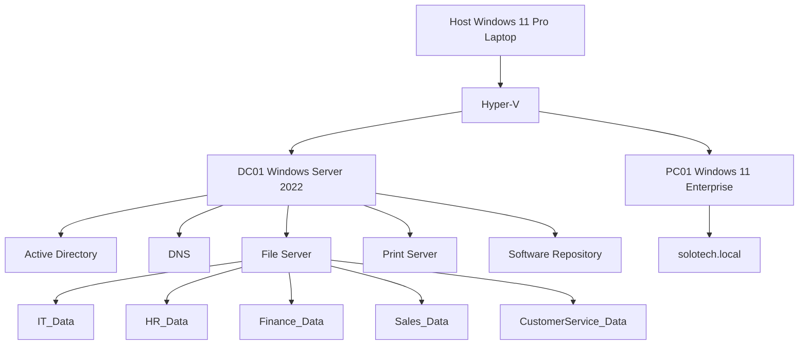

# SoloTech-Innovations---Enterprise-Active-Directory-Lab
Enterprise Active Directory Lab built using Windows Server 2022, Hyper-V, Group Policy and Windows 11.

## Infrastructure Overview

```
                            INTERNET
                                │
                     Home Router / WiFi
                                │
            ┌───────────────────┴───────────────────┐
            │                                       │
     Host Laptop                            HP DJ2700 Series Printer
   Windows 11 Pro
            │
            │
     Hyper-V External Switch
            │
 ┌──────────┴──────────┐
 │                     │
 ▼                     ▼

DC01                 PC01
Windows Server       Windows 11 Enterprise
2022

Active Directory
DNS
Print Server
File Server
Software Deployment

Domain:
solotech.local
```

## Domain Structure

solotech.local

└── SoloTech
    ├── IT
    ├── HR
    ├── Finance
    ├── Sales
    └── Customer Service
``
## Security Groups

IT-Team
HR-Team
Finance-Team
Sales-Team
CustomerService-Team

``
## Implemented Services

- Active Directory Domain Services
- DNS
- Shared Folders
- NTFS Permissions
- Group Policy
- Drive Mapping
- Printer Deployment
- Software Deployment
- Account Lockout Policies
- Password Policies

## Troubleshooting Experience

- Windows 11 TPM & Secure Boot Requirements
- Domain Trust Relationship Repair
- GPO Security Filtering Issues
- Drive Mapping Errors
- Printer Permission Issues
- Software Deployment Troubleshooting
- Password Lockout Investigations


2
# SoloTech Active Directory Lab




# Security Monitoring & Event Forwarding

## Overview

As part of the SoloTech Innovations Active Directory Lab, centralized Windows event monitoring was implemented to improve visibility, auditing, and security monitoring across domain-joined devices.

## Environment

| Device | Operating System | Role |
|----------|----------|----------|
| DC01 | Windows Server 2022 | Domain Controller / Event Collector |
| PC01 | Windows 11 Enterprise | Event Source |

Domain:

```text
solotech.local
```

## Implemented Features

### Windows Event Forwarding (WEF)

Successfully configured:

```text
PC01
   ↓
Windows Event Forwarding
   ↓
DC01 Event Collector
```

Events generated on PC01 are now collected and monitored centrally from DC01.

### Security Auditing

Enabled auditing through Group Policy for:

- Successful Logon Events
- Failed Logon Events
- Account Lockout Events
- Account Management Events
- User Authentication Events
- Security Log Monitoring

### Firewall Configuration

Configured Windows Firewall rules to allow:

```text
Windows Remote Event Log Management

Windows Event Collector Service

Windows Remote Management (WinRM)
```

ensuring successful communication between PC01 and DC01.

## Validation Tests Performed

### Logon Monitoring

Generated multiple successful and failed logon attempts on PC01 and confirmed events were received on DC01.

### Account Lockout Monitoring

Triggered account lockouts using the SoloTech Account Lockout Policy and verified collection of the resulting security events.

### Event Subscription Verification

Verified event subscriptions were:

```text
Active

Connected

Receiving Events
```

through Event Viewer on DC01.

## Key Event IDs Monitored

| Event ID | Description |
|-----------|-------------|
| 4624 | Successful Logon |
| 4625 | Failed Logon |
| 4720 | User Account Created |
| 4722 | Account Enabled |
| 4725 | Account Disabled |
| 4728 | Added to Security Group |
| 4729 | Removed from Security Group |
| 4740 | Account Locked Out |
| 1102 | Audit Log Cleared |

## Skills Demonstrated

- Windows Event Forwarding (WEF)
- Event Viewer Administration
- Security Auditing
- Active Directory Monitoring
- Windows Firewall Configuration
- Group Policy Administration
- Security Log Analysis
- Troubleshooting Event Collection
- Security Operations Fundamentals

## Cyber Security Relevance

This implementation introduces concepts commonly used in Security Operations Centres (SOC) and Security Information and Event Management (SIEM) platforms.

The architecture simulates the early stages of:

```text
Endpoint Monitoring
        ↓
Windows Event Forwarding
        ↓
Central Log Collection
        ↓
Threat Detection
        ↓
Security Investigation
```

This project serves as a foundation for future work with:

- Microsoft Sentinel
- Splunk
- Elastic SIEM
- Security Operations (SOC)
- Incident Response
- Threat Hunting
