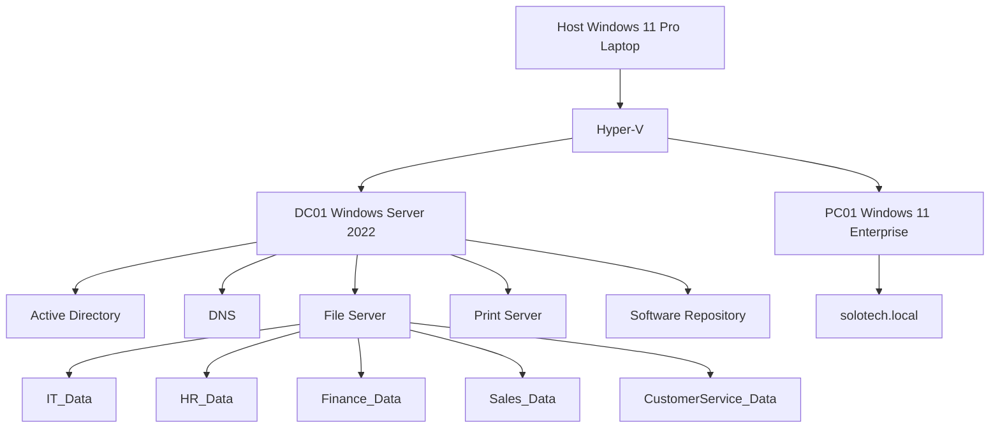

# SoloTech-Innovations---Enterprise-Active-Directory-Lab
Enterprise Active Directory Lab built using Windows Server 2022, Hyper-V, Group Policy and Windows 11.

## Infrastructure Overview

```
                            INTERNET
                                │
                     Home Router / WiFi
                                │
            ┌───────────────────┴───────────────────┐
            │                                       │
     Host Laptop                            HP DJ2700 Series Printer
   Windows 11 Pro
            │
            │
     Hyper-V External Switch
            │
 ┌──────────┴──────────┐
 │                     │
 ▼                     ▼

DC01                 PC01
Windows Server       Windows 11 Enterprise
2022

Active Directory
DNS
Print Server
File Server
Software Deployment

Domain:
solotech.local
```

## Domain Structure

solotech.local

└── SoloTech
    ├── IT
    ├── HR
    ├── Finance
    ├── Sales
    └── Customer Service
``
## Security Groups

IT-Team
HR-Team
Finance-Team
Sales-Team
CustomerService-Team

``
## Implemented Services

- Active Directory Domain Services
- DNS
- Shared Folders
- NTFS Permissions
- Group Policy
- Drive Mapping
- Printer Deployment
- Software Deployment
- Account Lockout Policies
- Password Policies

## Troubleshooting Experience

- Windows 11 TPM & Secure Boot Requirements
- Domain Trust Relationship Repair
- GPO Security Filtering Issues
- Drive Mapping Errors
- Printer Permission Issues
- Software Deployment Troubleshooting
- Password Lockout Investigations


2
# SoloTech Active Directory Lab




``
## solotech-active-directory-lab

│
├── README.md
│
├── Architecture
│   ├── Network_Diagram.png
│
├── Screenshots
│   ├── DC01.png
│   ├── ActiveDirectory.png
│   ├── GPO.png
│   ├── DriveMappings.png
│   ├── PrinterDeployment.png
│
├── Documentation
│   ├── Project_Report.docx
│   ├── Troubleshooting_Cases.docx
│
└── Tickets
    ├── INC001_Account_Lockout.md
    ├── INC002_Password_Reset.md
    └── etc
``
