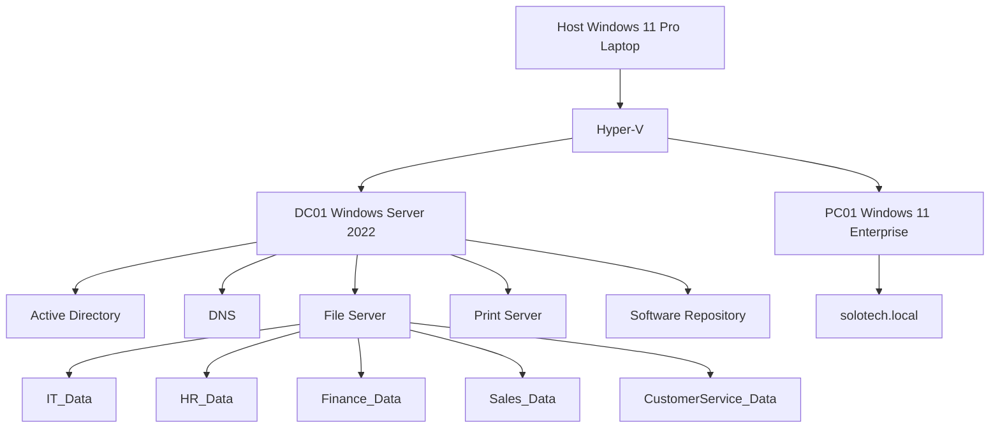
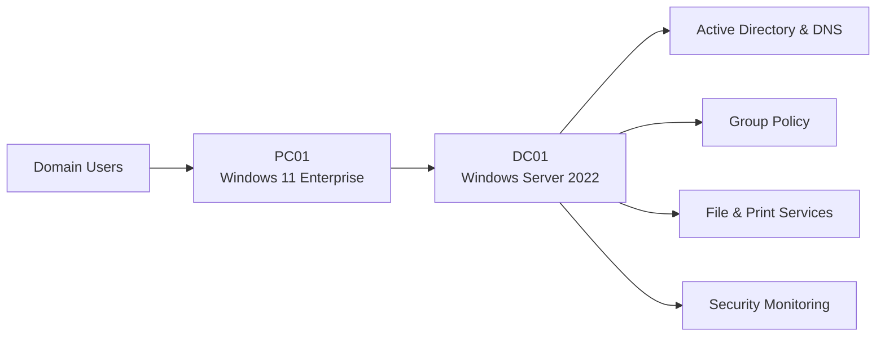
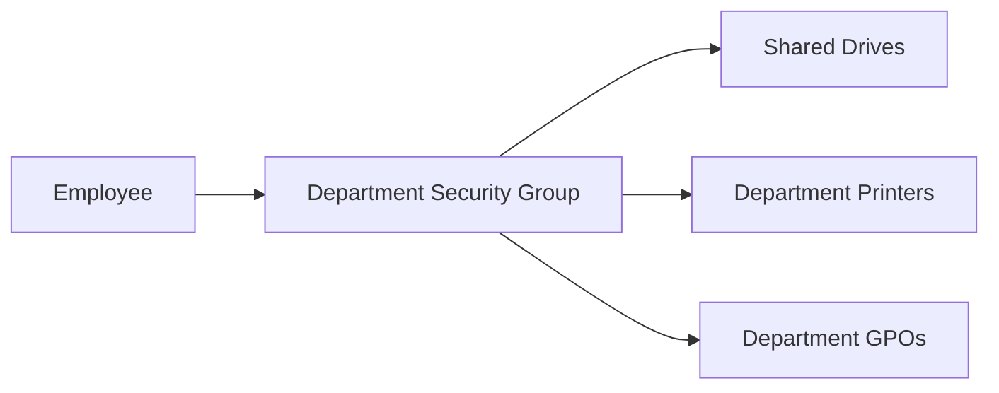
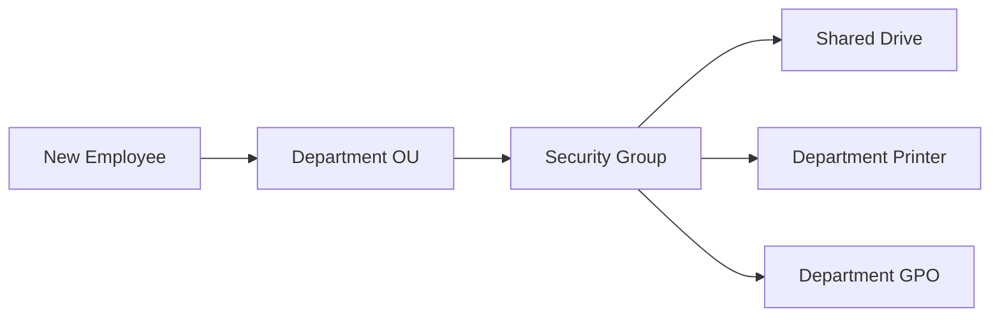
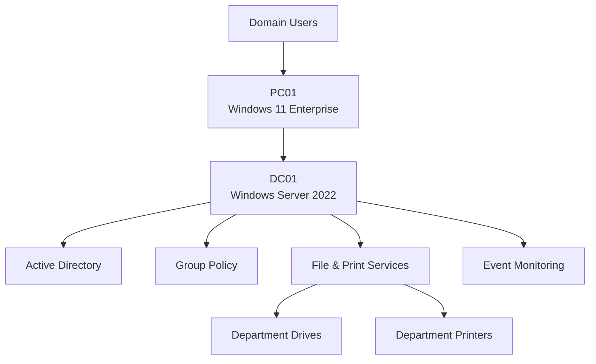
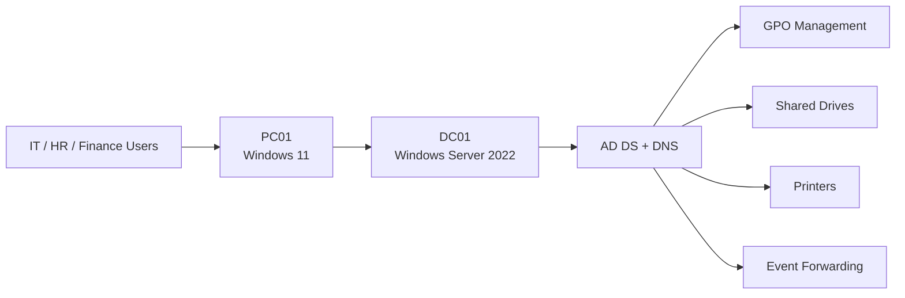
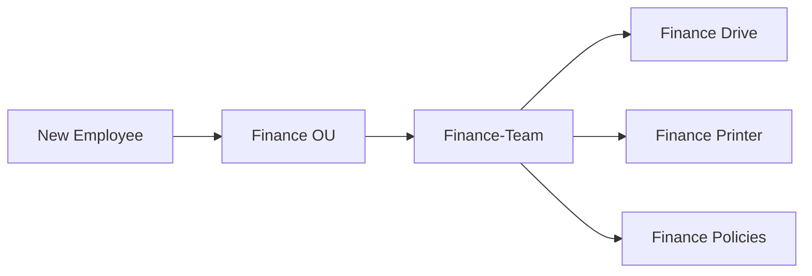

# SoloTech-Innovations---Enterprise-Active-Directory-Lab
Enterprise Active Directory Lab built using Windows Server 2022, Hyper-V, Group Policy and Windows 11.

## Infrastructure Overview

```
                            INTERNET
                                │
                     Home Router / WiFi
                                │
            ┌───────────────────┴───────────────────┐
            │                                       │
     Host Laptop                            HP DJ2700 Series Printer
   Windows 11 Pro
            │
            │
     Hyper-V External Switch
            │
 ┌──────────┴──────────┐
 │                     │
 ▼                     ▼

DC01                 PC01
Windows Server       Windows 11 Enterprise
2022

Active Directory
DNS
Print Server
File Server
Software Deployment

Domain:
solotech.local
```

## Domain Structure

solotech.local

└── SoloTech
    ├── IT
    ├── HR
    ├── Finance
    ├── Sales
    └── Customer Service
``
## Security Groups

IT-Team
HR-Team
Finance-Team
Sales-Team
CustomerService-Team

``
## Implemented Services

- Active Directory Domain Services
- DNS
- Shared Folders
- NTFS Permissions
- Group Policy
- Drive Mapping
- Printer Deployment
- Software Deployment
- Account Lockout Policies
- Password Policies

## Troubleshooting Experience

- Windows 11 TPM & Secure Boot Requirements
- Domain Trust Relationship Repair
- GPO Security Filtering Issues
- Drive Mapping Errors
- Printer Permission Issues
- Software Deployment Troubleshooting
- Password Lockout Investigations


2
# SoloTech Active Directory Lab


# SoloTech Innovations Enterprise Infrastructure Lab

## Overview

SoloTech Innovations is a hands-on enterprise IT infrastructure lab built using:

- Windows Server 2022
- Windows 11 Enterprise
- Hyper-V
- Active Directory Domain Services (AD DS)
- DNS
- Group Policy
- Shared File Services
- Print Services
- Software Deployment
- Windows Event Forwarding

The project was designed to simulate real-world IT Support, Systems Administration, and Cyber Security operations in a small-to-medium business environment.

---

# Technical Architecture



---

# Infrastructure Components

## DC01

**Operating System**

```text
Windows Server 2022
```

**Services**

- Active Directory Domain Services
- DNS
- Group Policy Management
- File Server
- Print Server
- Software Repository
- Event Collector

---

## PC01

**Operating System**

```text
Windows 11 Enterprise
```

**Purpose**

- Domain workstation
- Group Policy testing
- Software deployment testing
- Security monitoring
- User authentication testing

---

## Domain

```text
solotech.local
```

---

# Active Directory Structure

```text
solotech.local

└── SoloTech
    ├── IT
    ├── HR
    ├── Finance
    ├── Sales
    └── Customer Service
```

---

# Identity & Access Management

## Security Groups

```text
IT-Team

HR-Team

Finance-Team

Sales-Team

CustomerService-Team

Finance-Team-Payroll
```

## RBAC Model



---

# Shared Drive Infrastructure

Departmental file shares were created and secured using:

- Share Permissions
- NTFS Permissions
- Active Directory Security Groups

Examples:

```text
IT_Data

HR_Data

FINANCE_Data

SALES_Data

CS_Data
```

A separate Payroll security model was implemented using:

```text
Finance-Team-Payroll
```

to enforce least-privilege access.

---

# Automated Printer Deployment

## Project Objective

Automatically deploy departmental printers based on group membership while enforcing role-based access control.

## Printer Architecture


## Challenges Encountered

### Initial Deployment Failure

Users were required to manually browse:

```text
\\DC01
```

and connect to printers before they became available.

### Root Cause

Printer deployment permissions and Group Policy targeting were not aligned.

### Resolution

Printer deployment was redesigned using:

```text
Authenticated Users
        +
Group Policy Item-Level Targeting
        +
Department Security Groups
```

This provided:

- Automated deployment
- Department-specific assignment
- Reduced administrative effort

---

# Default Printer Automation

Windows was automatically assigning:

```text
Microsoft Print to PDF
```

as the default printer.

To resolve this:

- Disabled "Let Windows manage my default printer"
- Implemented registry-based GPO settings
- Enforced departmental printers as the default printer

Example:

```text
Finance User
        ↓
FINANCE-PRINTER

HR User
        ↓
HR-PRINTER

IT User
        ↓
IT-PRINTER
```

---

# Printer Lifecycle Management

When a user changes department:

```text
Old Department Printer
        ↓
Automatically Removed

New Department Printer
        ↓
Automatically Installed

Default Printer
        ↓
Automatically Updated
```

No manual administrator intervention is required.

---

# New Employee Onboarding Project

## Ticket Scenario

A request was received to provision a new Finance Assistant account.

### Requirements

- Finance drive access
- Finance printer access
- No Payroll access
- No access to other departments

### Provisioning Process

Created user account:

```text
solotech.local
└── SoloTech
    └── Finance
```

Assigned:

```text
Domain Users

Finance-Team
```

Configured:

- Temporary password
- Password change at first logon
- Department details
- Manager information
- Office location

### Security Controls

Payroll access was isolated through:

```text
Finance-Team-Payroll
```

The new employee was deliberately excluded from this group.

### Validation Results

| Resource | Result |
|-----------|---------|
| Finance Drive | ✅ Accessible |
| Finance Documents | ✅ Read & Write |
| Payroll Folder | ❌ Access Denied |
| Finance Printer | ✅ Accessible |
| Other Departments | ❌ Access Denied |

---

# Group Policy Projects

Successfully implemented:

- Password Complexity Policy
- Account Lockout Policy
- HR Wallpaper Deployment
- Department Drive Mapping
- Printer Deployment
- Software Deployment
- Customer Service Restrictions
- Event Logging Policies

---

# Security Monitoring

## Windows Event Forwarding

Successfully configured:

```text
PC01
    ↓
Windows Event Forwarding
    ↓
DC01 Event Collector
```

## Security Events Monitored

- Successful Logons (4624)
- Failed Logons (4625)
- Account Lockouts (4740)
- User Account Changes
- Security Group Changes

## Security Monitoring Architecture

```text
PC01
│
├── Security Events
├── Logon Events
├── Lockout Events
│
▼
Windows Event Forwarding
│
▼
DC01 Event Collector
│
├── Monitoring
├── Auditing
└── Investigation
```

---

# Technical Skills Demonstrated

## Infrastructure

- Windows Server 2022
- Windows 11 Enterprise
- Hyper-V
- DNS
- AD DS

## Identity & Access Management

- Active Directory Administration
- User Provisioning
- Security Groups
- Role-Based Access Control
- Least Privilege

## Group Policy

- GPO Design
- Security Filtering
- Delegation
- Printer Deployment
- Software Deployment
- Drive Mapping

## File Services

- NTFS Permissions
- Shared Folders
- Access Control

## Security

- Windows Event Forwarding
- Security Auditing
- Account Lockout Monitoring
- Event Analysis

## Support & Troubleshooting

- Trust Relationship Recovery
- GPO Troubleshooting
- Printer Deployment Issues
- DNS Troubleshooting
- Windows 11 Installation Issues
- Root Cause Analysis

---

# Key Outcome

This lab successfully evolved from a basic Active Directory environment into a miniature enterprise infrastructure platform incorporating:

✅ Identity Management

✅ Access Control

✅ Group Policy Automation

✅ File & Print Services

✅ Software Distribution

✅ Security Monitoring

✅ User Lifecycle Management

✅ IT Support Operations

✅ Cyber Security Foundations


# Security Monitoring & Event Forwarding

## Overview

As part of the SoloTech Innovations Active Directory Lab, centralized Windows event monitoring was implemented to improve visibility, auditing, and security monitoring across domain-joined devices.

## Environment

| Device | Operating System | Role |
|----------|----------|----------|
| DC01 | Windows Server 2022 | Domain Controller / Event Collector |
| PC01 | Windows 11 Enterprise | Event Source |

Domain:

```text
solotech.local
```

## Implemented Features

### Windows Event Forwarding (WEF)

Successfully configured:

```text
PC01
   ↓
Windows Event Forwarding
   ↓
DC01 Event Collector
```

Events generated on PC01 are now collected and monitored centrally from DC01.

### Security Auditing

Enabled auditing through Group Policy for:

- Successful Logon Events
- Failed Logon Events
- Account Lockout Events
- Account Management Events
- User Authentication Events
- Security Log Monitoring

### Firewall Configuration

Configured Windows Firewall rules to allow:

```text
Windows Remote Event Log Management

Windows Event Collector Service

Windows Remote Management (WinRM)
```

ensuring successful communication between PC01 and DC01.

## Validation Tests Performed

### Logon Monitoring

Generated multiple successful and failed logon attempts on PC01 and confirmed events were received on DC01.

### Account Lockout Monitoring

Triggered account lockouts using the SoloTech Account Lockout Policy and verified collection of the resulting security events.

### Event Subscription Verification

Verified event subscriptions were:

```text
Active

Connected

Receiving Events
```

through Event Viewer on DC01.

## Key Event IDs Monitored

| Event ID | Description |
|-----------|-------------|
| 4624 | Successful Logon |
| 4625 | Failed Logon |
| 4720 | User Account Created |
| 4722 | Account Enabled |
| 4725 | Account Disabled |
| 4728 | Added to Security Group |
| 4729 | Removed from Security Group |
| 4740 | Account Locked Out |
| 1102 | Audit Log Cleared |

## Skills Demonstrated

- Windows Event Forwarding (WEF)
- Event Viewer Administration
- Security Auditing
- Active Directory Monitoring
- Windows Firewall Configuration
- Group Policy Administration
- Security Log Analysis
- Troubleshooting Event Collection
- Security Operations Fundamentals

## Cyber Security Relevance

This implementation introduces concepts commonly used in Security Operations Centres (SOC) and Security Information and Event Management (SIEM) platforms.

The architecture simulates the early stages of:

```text
Endpoint Monitoring
        ↓
Windows Event Forwarding
        ↓
Central Log Collection
        ↓
Threat Detection
        ↓
Security Investigation
```

# IT Service Management & User Onboarding

## Ticket Reference

INC-003 – New Employee Onboarding

## Business Request

The Finance Manager submitted a request for a new joiner:

```text
Name: Daniel Dokafor
Role: Finance Assistant
Department: Finance
```

Required access:

- Finance shared drive
- Finance department printer
- Standard domain access

Restrictions:

- No Payroll access
- No access to other departmental resources
- No access to other departmental printers

## Pre-Provisioning Verification

Before account creation, approval was verified from:

- Hiring Manager
- Human Resources

This follows standard onboarding and identity management procedures.

## Active Directory Provisioning

Account created in:

```text
solotech.local
└── SoloTech
    └── Finance
         └── dokafor
```

User configuration:

- Temporary password assigned
- Password change required at first logon
- No account expiration date
- Department information completed
- Job title completed
- Manager assigned
- Office location recorded

## Security Group Assignment

Assigned Groups:

```text
Domain Users

Finance-Team
```

Access granted through Finance-Team:

- FINANCE_Drive
- FINANCE-PRINTER
- General Finance documents

## Least Privilege Access Implementation

A sensitive Payroll folder was identified during the onboarding process.

A dedicated security group was created:

```text
Finance-Team-Payroll
```

NTFS permissions were modified so that:

```text
Finance-Team-Payroll
```

retains Payroll access.

```text
Finance-Team
```

was removed from Payroll permissions.

Daniel was intentionally excluded from:

```text
Finance-Team-Payroll
```

as part of least-privilege access control.

## Validation Testing

Testing was performed using the newly created account.

| Resource | Result |
|-----------|----------|
| Finance Shared Drive | ✅ Accessible |
| Finance Documents | ✅ Read/Write Access |
| Payroll Folder | ❌ Access Denied |
| Finance Printer | ✅ Accessible |
| Other Department Drives | ❌ Not Accessible |
| Other Department Printers | ❌ Not Accessible |

## Resolution

User account successfully provisioned according to business requirements.

Access was assigned using:

- Active Directory Security Groups
- NTFS Permissions
- Role Based Access Control (RBAC)
- Least Privilege Principles

## Skills Demonstrated

- New Employee Onboarding
- Active Directory Administration
- User Provisioning
- Identity & Access Management
- Security Group Administration
- NTFS Permissions Management
- Role Based Access Control (RBAC)
- Least Privilege Security
- Printer Deployment
- Shared Drive Administration
- Access Verification
- Service Desk Documentation

## Cyber Security Relevance

This onboarding process implemented:

```text
Identity Governance

Least Privilege Access

Separation of Duties

Access Control Validation

Role-Based Security
```

These are foundational security principles used in enterprise environments and Security Operations teams.

This project serves as a foundation for future work with:

- Microsoft Sentinel
- Splunk
- Elastic SIEM
- Security Operations (SOC)
- Incident Response
- Threat Hunting


# Automated & Self-Cleaning Enterprise Printer Deployment Architecture

A centralized, automated, and self-cleaning printer deployment solution utilizing **Windows Server 2022 Active Directory Domain Services (AD DS)**, **Group Policy Preferences (GPP)**, and **Item-Level Targeting**. 

This architecture ensures that users automatically map and default to their respective department's printers based strictly on their Active Directory security group memberships with zero manual IT support intervention.

---

## 🛠️ Architecture Workflow Diagram

```text
[ Active Directory Users ]
           │
           ▼
┌────────────────────────────────────────────────────────┐
│  1. User Logs On / GPO Triggers                       │
└────────────────────────────────────────────────────────┘
           │
           ▼
┌────────────────────────────────────────────────────────┐
│  2. Registry Preference (Processes First)              │
│     Sets: LegacyDefaultPrinterMode = 1                 │
│     Blocks: "Allow Windows to manage my default..."    │
└────────────────────────────────────────────────────────┘
           │
           ▼
┌────────────────────────────────────────────────────────┐
│  3. GPP Printer 'Replace' Cycle Evaluated             │
└────────────────────────────────────────────────────────┘
           │
           ├─► [User in 'Print-Finance' Group?] ──► YES: Map Finance Printer & Set Default
           │                                    └──► NO:  [Remove Device if previously mapped]
           │
           └─► [User in 'Print-HR' Group?]      ──► YES: Map HR Printer & Set Default
                                                └──► NO:  [Remove Device if previously mapped]
```

---

## 🎯 Technical Challenges Addressed

1. **Departmental Isolation:** Restricting network printer visibility so users can only see, list, and interact with their specific department's hardware.
2. **Dynamic Cross-Department Transfers:** Automatically purging stale printer mappings when a user shifts to a new department or security group, mitigating profile clutter.
3. **The "Print to PDF" Hijack:** Preventing Windows 10/11 client machines from falling back to "Microsoft Print to PDF" as the system default during policy refresh cycles.
4. **Permissions Overhead:** Preserving standard print server Access Control Lists (ACLs) to ensure drivers pull reliably without throwing "Access Denied" errors.

---

## ⚙️ Core Implementation Details

### 1. Visibility Filter via Item-Level Targeting
Instead of deploying printers globally to an entire Organizational Unit (OU), mappings are controlled via targeted Active Directory Security Groups (e.g., `Print-Finance`, `Print-HR`).
* **GPO Location:** `User Configuration` > `Preferences` > `Control Panel Settings` > `Printers`
* **Filtering Gatekeeper:** Configured on the **Common Tab** using **Item-Level Targeting**, mapping the preference rule specifically to `User is a member of the Security Group`.
* **Print Server Security:** Permissions on the Print Server are left at their healthy default (**Everyone: Print**). Security is cleanly managed at the GPO presentation layer rather than the server's ACLs.

### 2. Automated Self-Cleaning Configuration
To ensure the environment stays entirely clean if an employee changes departments, the policy alters the default GPO behavior:
* Enabled **"Remove this item when it is no longer applied"** under the GPP Common Tab.
* This changes the internal mechanics from an *Update* action to a **Replace** action (symbolized by a **Red Icon** in the Group Policy Management Console).
* At every background policy check or login, Windows validates group membership. If membership has been stripped, the old device is instantly deleted from the client workstation.

### 3. Securing the Default Status
Because the *Replace* action quickly tears down and rebuilds network printers during background refreshes, Windows clients can temporarily drop the network connection for a split second, defaulting back to *Microsoft Print to PDF*.

This layout guarantees absolute default persistence by enforcing two rules in a precise **Order of Operations**:
* **Administrative Template:** Enforced `Turn off Windows default printer management` under *User Configuration > Policies > Administrative Templates > Control Panel > Printers*.
* **Registry Pre-Conditioning:** Deployed a GPP Registry update to push `LegacyDefaultPrinterMode = 1` (REG_DWORD) under `HKCU\Software\Microsoft\Windows NT\CurrentVersion\Windows`.

# Technical Architecture Diagram

``
## User Provisioning Model


    EVENTS --> LOGON[Logon Events]
    EVENTS --> LOCKOUT[Account Lockouts]
    EVENTS --> MANAGEMENT[Account Management Events]

    PAYGROUP --> PAYROLL

```

* **The Fix:** Because **Windows Settings (Registry)** processes cleanly before **Control Panel Settings (Printers)**, Windows is safely locked into classic printer management *before* the printer's replace cycle triggers, successfully maintaining the primary department printer's default status.

---

## 🚀 Results & Impact

* **Zero-Touch IT Lifecycle Management:** Onboarding or transferring an employee dynamically provisions their localized workplace printing setup without desktop support tickets.
* **Confidentiality Assistance:** Minimizes security leaks where users mistakenly send sensitive data to the wrong department's physical queue.
* **Consistent User Profiles:** Eradicates local registry drift and driver anomalies across user desktop configurations.


# Automated Departmental Printer Deployment

## Objective

Implement automated printer deployment based on department membership using Active Directory Security Groups and Group Policy Preferences.

## Initial Challenge

The original printer deployment did not automatically install printers for users at first sign-in.

Users were required to manually browse:

```text
\\DC01
```

and connect to their departmental printer before the printer became available.

This behavior did not meet the desired enterprise standard for automated provisioning.

## Investigation

Several deployment methods were evaluated.

### Attempt 1

Used:

```text
Microsoft Print to PDF
```

as a test printer.

Outcome:

```text
Unsuccessful
```

Microsoft Print to PDF could not be shared in a way that supported the deployment requirements.

### Attempt 2

A physical HP wireless printer was integrated into the SoloTech lab.

Infrastructure:

```text
Host Network
    ↓
Hyper-V External Switch
    ↓
DC01
    ↓
HP Network Printer
```

The printer was installed on DC01 and additional logical departmental printers were created using the HP print driver.

## Department Printer Structure

```text
IT-PRINTER

HR-PRINTER

FINANCE-PRINTER

SALES-PRINTER

CUST-SERV-PRINTER
```

## Printer Security Configuration

Initially:

```text
Everyone
```

had print permissions.

Result:

```text
All users could access all printers.
```

This violated least-privilege principles.

### Resolution

Removed:

```text
Everyone
```

from printer permissions.

Assigned department security groups:

```text
IT-Team

HR-Team

Finance-Team

Sales-Team

CustomerService-Team
```

to their corresponding printers.

## Printer Automation

Implemented Group Policy Preferences to:

- Deploy departmental printers automatically.
- Set departmental printers as default printers.
- Override Microsoft "Manage my default printer" behavior.
- Remove printers when users move departments.
- Deploy the correct printer based on current group membership.

### Example

User:

```text
Finance-Team
```

Receives:

```text
FINANCE-PRINTER
```

as default printer.

If reassigned to:

```text
HR-Team
```

the system automatically:

```text
Removes FINANCE-PRINTER

Deploys HR-PRINTER

Sets HR-PRINTER as default
```

without manual administrator intervention.

## Security Validation

Testing confirmed:

| Scenario | Result |
|-----------|----------|
| IT User → IT Printer | ✅ Allowed |
| IT User → HR Printer | ❌ Access Denied |
| IT User → Finance Printer | ❌ Access Denied |
| Finance User → Finance Printer | ✅ Allowed |
| Customer Service User → CS Printer | ✅ Allowed |
| Unauthorized User → Department Printer | ❌ Access Denied |

## Skills Demonstrated

- Print Management
- Group Policy Preferences
- Active Directory Security Groups
- Role Based Access Control (RBAC)
- Least Privilege Access
- Printer Security
- Enterprise Printer Deployment
- Lifecycle Access Management
- User Provisioning
- User Offboarding and Role Changes

## Cyber Security Relevance

This implementation demonstrates:

```text
Least Privilege

Role Based Access Control

Resource Segregation

Identity-Based Access Management

Automated Access Governance
```

which are foundational concepts used in enterprise security and identity management environments.


## Advanced Printer Deployment & Lifecycle Management

### Business Objective

Implement fully automated printer deployment based on departmental membership.

### Challenges Encountered

Initial deployment methods did not automatically provision printers during user sign-in.

Users were required to manually browse:

```text
\\DC01
```

and connect to printers before they became available.

Windows also automatically changed default printers based on recent usage.

### Final Solution

Implemented:

- Group Policy Printer Deployment
- Security Group Targeting
- Registry-based printer configuration
- Default printer enforcement
- Automatic printer replacement during department changes

### Deployment Logic

```text
Finance-Team
↓
Deploy FINANCE-PRINTER
↓
Set FINANCE-PRINTER as Default
```

```text
HR-Team
↓
Deploy HR-PRINTER
↓
Set HR-PRINTER as Default
```

### Lifecycle Automation

When a user changes department:

```text
Old Department Printer
↓
Automatically Removed

New Department Printer
↓
Automatically Installed

Default Printer
↓
Automatically Updated
```

### Skills Demonstrated

- Group Policy Preferences
- Printer Deployment
- Registry Configuration
- Identity-Based Resource Assignment
- User Lifecycle Management
- Role-Based Access Control (RBAC)
- Enterprise Desktop Administration


# RBAC (Role-Based Access Control) Model

```text
Finance User
      │
      ▼
Finance-Team
      │
      ├── FINANCE_Drive
      ├── FINANCE-PRINTER
      └── Finance Documents

Finance-Team-Payroll
      │
      └── Payroll Folder

Only Approved Payroll Staff
      │
      ▼
Finance-Team-Payroll
      │
      ▼
Payroll Access Granted

All Other Finance Users
      │
      ▼
Payroll Access Denied
```

# Security Monitoring Architecture

```text
PC01
│
├── Successful Logons (4624)
├── Failed Logons (4625)
├── Account Lockouts (4740)
├── Account Management Events
│
▼
Windows Event Forwarding
│
▼
DC01 Event Collector
│
├── Security Monitoring
├── Audit Review
├── Incident Investigation
└── Compliance Logging
```


## SoloTech Infrastructure Architecture


``
## SoloTech Active Directory Environment


## Printer Deployment Model


## User Provisioning Workflow



